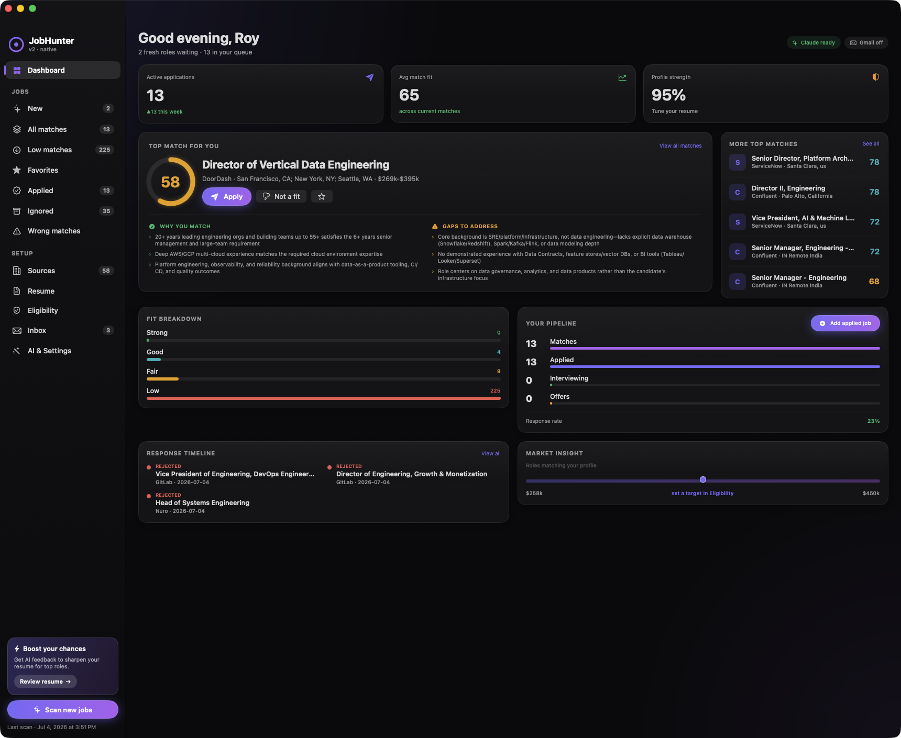
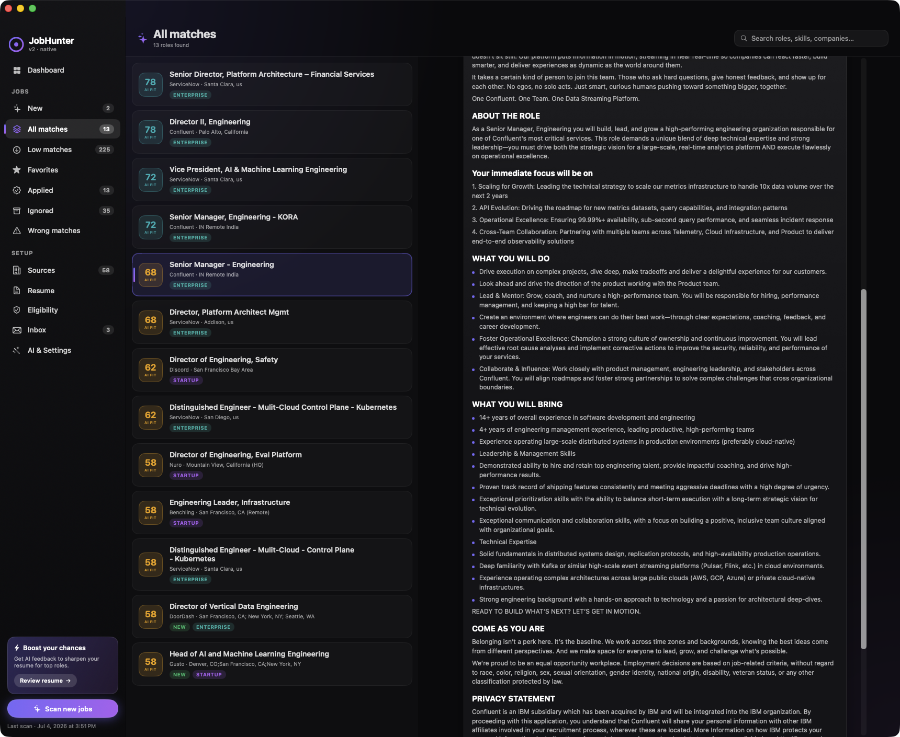

<div align="center">

# JobHunter

**A native macOS app that finds roles worth applying to, scores each one against your resume, and tracks every application from _New_ to _Offer_ - all on your Mac. No account, no server, no subscription.**

[](https://github.com/kodelint/jobhunter/releases)
[](https://github.com/kodelint/jobhunter/actions/workflows/release.yml)
[](https://github.com/kodelint/jobhunter/actions/workflows/ci.yml)
[](https://github.com/kodelint/jobhunter/releases)
[](LICENSE)
[](https://www.apple.com/macos)
[](https://swift.org)
[](https://developer.apple.com/xcode/swiftui/)
[](#tech)



</div>

## Why I built this

I kept losing track of my own job hunt. Openings lived across a dozen career sites, "did I already apply here?" was a spreadsheet I never updated, and recruiter replies got buried in Gmail. Every tool I tried wanted an account, a subscription, and my data.

So I built **JobHunter**: it pulls openings straight from company career APIs, ranks them against my actual resume, and keeps the whole pipeline - applied, interviewing, offer, rejected - in one local app. It reads your resume to learn what _you_ want, so it works whether you're a platform engineer, a nurse manager, a data scientist, or a VP. Your resume, keys, and history stay in a local SQLite file on your machine.

It's the tool I wished existed, so I open-sourced it.

## Highlights

- **One scan, every board.** Fetches current postings from Greenhouse, Ashby, Lever, and SmartRecruiters in a single pass (50+ companies seeded; add your own by career-board token).
- **Fit, not keyword soup.** Reads your resume, derives your target titles / seniority / skills, and scores every posting. Optional AI gives a 0-100 fit verdict with concrete reasons and honest gaps.
- **A real pipeline.** New -> Applied -> Interviewing -> Offer / Rejected, with follow-up reminders and per-role notes.
- **It learns your taste.** Flag a role as a _wrong match_ and tell it why; future scans score similar off-profile roles lower.
- **Track anything.** Applied somewhere outside your sources (a Workday portal, a referral)? Add it manually and it lives in the same pipeline.
- **Optional Gmail sync.** Reads your inbox over IMAP to auto-detect interview / offer / rejection replies and advance the matching application - no OAuth, no Google Cloud project.
- **100% local.** Nothing is uploaded anywhere except the AI provider you choose, and only if you turn AI on.

## Screenshots

| Dashboard | Matches + role detail |
| :---: | :---: |
|  |  |

## How it works

Each scan runs a small, predictable pipeline:

1. **Source** - conditional-GET fetches (ETag / 304) from every enabled career board, so unchanged boards aren't re-downloaded. Postings get deterministic IDs, so a rescan doesn't re-add everything as "new".
2. **Score** - a fast, local, off-main-thread keyword pass ranks each posting against your resume profile and drops roles you've flagged.
3. **Evaluate (optional)** - for the top matches only, an AI model reads the job against your resume and returns a fit score, a one-line verdict, why-you-match reasons, gaps, and five per-signal sub-scores. Runs concurrently and reuses cached scores across scans.
4. **Track** - results land in your pipeline. Apply, snooze, add notes, set follow-ups, mark wrong matches.

With no resume analyzed yet, JobHunter falls back to a sensible built-in profile so it's useful on first launch.

## Features in detail

### Sourcing
- Live fetch across **Greenhouse, Ashby, Lever, and SmartRecruiters**.
- Conditional GET with ETag / If-Modified-Since so unchanged boards return `304` and cost nothing.
- SmartRecruiters pagination with description backfill for _new_ postings only (bounded per scan).
- Deterministic FNV-1a IDs, so rescans update in place instead of flooding "New".
- Add companies by their career-board token; enable/disable any source.

### Matching & scoring
- **Resume analysis** extracts your target titles, seniority band, atomic skills, and country.
- **Local keyword scorer** weighs function + skill relevance, with a level-band filter (target seniority and up, unless you opt in to see below).
- **Optional AI evaluation** via **Claude, GPT, Gemini, or a local model** (Ollama-compatible) - a 0-100 score, verdict, reasons, gaps, and per-signal sub-scores (leadership, location, technical, domain, compensation).
- **Location filter** with country + state matching and an include-anywhere-remote toggle.
- Only the top matches are sent to AI (configurable), and already-scored roles are never re-sent - so scans stay cheap.

### Wrong-match feedback (it learns)
- Mark a role as a **wrong match** (wrong function, domain, seniority, or location) and give a reason.
- The reason is stored and injected into future AI evaluations as a negative signal, so similar off-profile roles score lower.
- Distinct from **Ignore**, which is a silent personal "not interested" that never trains the AI.

### Application tracking
- Tabs for **New / All / Low / Favorites / Applied / Ignored / Wrong matches**.
- Pipeline stages, follow-up dates with reminders, per-role notes, and favorites.
- **Manual entry** for applications made outside your sources (Workday, referrals, LinkedIn) - tracked in the same pipeline, and picked up by Gmail sync automatically.

### Eligibility & constraints
- Parses each posting for **work authorization, comp range, remote/hybrid/onsite, years of experience, IC vs. management, travel, and clearance**.
- Set your own eligibility (status, comp floor, work styles, country) and optionally hide anything you're not eligible for.

### Gmail inbox sync (optional)
- Connects over IMAP with a Gmail **app password** (needs 2-Step Verification + IMAP enabled). No OAuth, no cloud project.
- Classifies recent replies into interview / offer / rejection and advances the matching application's stage.
- Credentials go in a `0600` netrc file, never on the process argv.

### Dashboard
- Warm, time-aware greeting and a **top-pick spotlight** with the AI's why-you-match / gaps.
- KPI row, per-signal **fit breakdown**, an application **pipeline** with response rate, a **new-matches-per-week** chart, response timeline, follow-ups, and a market comp band inferred from your matches.
- Modules that have no data (or need a connection you haven't made, like Gmail-gated interviews) simply don't render - no empty frames.

### Privacy & security
- Resume, application history, and cache live in a local SQLite database (`~/Library/Application Support/JobHunter`).
- API keys are stored in the macOS **Keychain** (or read from your shell environment).
- The only outbound calls are to the AI provider you pick (when AI is on) and to the public career-board APIs.

## Install

Download the latest `JobHunter-vX.Y.Z.dmg` from [**Releases**](https://github.com/kodelint/jobhunter/releases), open it, and drag JobHunter to Applications.

The build is ad-hoc signed (not notarized), so the first launch needs a **right-click -> Open** (or _System Settings -> Privacy & Security -> Open Anyway_).

**Requirements:** macOS 14 (Sonoma) or later. Universal binary (Apple Silicon + Intel).

## Build from source

No package manager, no Xcode project - just `swiftc`.

```bash
git clone https://github.com/kodelint/jobhunter.git
cd jobhunter
./scripts/build-dmg.sh          # builds a universal .app + DMG into dist/
open build/JobHunter.app        # run it
```

Handy scripts:

| Script | What it does |
| --- | --- |
| `scripts/build-dmg.sh` | Compile the universal binary, bundle, sign, and package a DMG. |
| `scripts/compile-check.sh` | Fast type-check of the whole app (arm64). |
| `scripts/run-selfcheck.sh` | Run the pure-logic self-checks (`selfcheck OK`). |

Set `DEVELOPER_ID` (and notary credentials) before `build-dmg.sh` to produce a signed, notarizable build.

## Tech

- **SwiftUI** UI, compiled directly with `swiftc` (no Xcode project, no SwiftPM manifest).
- **SQLite3** via the system library for storage - zero third-party dependencies.
- Concurrency: a `@MainActor` database with CPU/network work on detached tasks handing back `Sendable` values.

## Releases & CI

- Pushing a `vX.Y.Z` tag builds a universal DMG and publishes a GitHub Release with autogenerated notes (see `.github/workflows/release.yml`).
- Every push / PR to `main` runs a type-check and the logic self-checks (`.github/workflows/ci.yml`).
- Versioning follows [Semantic Versioning](https://semver.org).

## Contributing

Issues and PRs welcome. Commits follow [Conventional Commits](https://www.conventionalcommits.org) (`feat:`, `fix:`, `docs:`, `ci:`, ...). Run `scripts/compile-check.sh` and `scripts/run-selfcheck.sh` before opening a PR.

## License

[MIT](LICENSE) © kodelint
